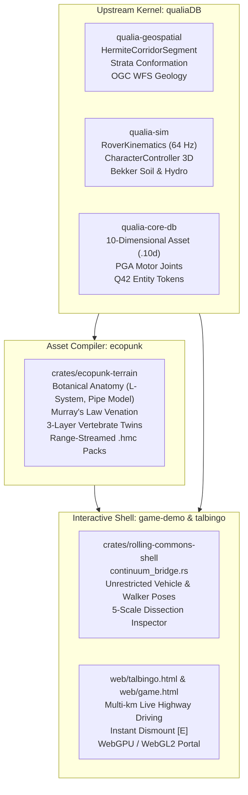

# Talbingo Regional Continuum & Biological Education Architecture

**Kosciuszko National Park & Snowy Mountains Highway B72 Digital Twin**  
*Unified Biophysical Simulation, Multi-Kilometer Drivable Corridor, and 5-Scale Biological Digital Twin Assets*

---

## 1. Executive Summary

`talbingo` represents the high-fidelity scientific digital twin of the **Snowy Mountains Highway (B72)** regional corridor within **Kosciuszko National Park**, New South Wales, Australia. Spanning from Blowering Reservoir at **385 m AHD** to the subalpine Kiandra plateau at **1,410 m AHD**, the system integrates:

1. **A Continuous 17.5+ km Hermite Spline Roadbed & Fire-Trail Network:**  
   Eliminating legacy 64m × 44m isolated scene patches and 22m vehicle rails, providing contiguous 64 Hz 4-wheel rover driving and unrestricted on-foot bushwalker exploration.
2. **A 5-Scale Botanical & Zoological Educational Dissection Pipeline:**  
   High-resolution `.10d` asset containers modeling organisms from whole canopy/root architecture down to cellular stomatal histology and vertebrate osteology, rigorously grounded in **Plant Ontology (`PO:`)** and **Uberon (`UBERON:`)**.
3. **Tri-Repository Architectural Integration:**  
   Harmonizing the biophysical kernels of `qualiaDB`, the asset compiler of `ecopunk`, and the real-time WASM/WebGPU runtime of `game-demo`.

---

## 2. Regional Highway Continuum (Sites 0 through 5)

The regional continuum models the real elevation profile, geology, and ecology along the Snowy Mountains Highway B72:

| Site | Name | Chainage | Elevation | Geological Unit | Dominant Flora | Signature Fauna |
|:---:|:---|:---:|:---:|:---|:---|:---|
| **0** | **The Pines Foreshore** | km 0.0 | 385 m AHD | *Blowering Formation* (Silurian rhyolitic tuff) | *Corymbia aparrerinja* / *Eucalyptus viminalis* | *Macropus giganteus* (Eastern Grey Kangaroo) |
| **1** | **Humes Crossing** | km 1.8 | 386 m AHD | *Blowering Formation* (Siltstone & alluvial shale) | *Eucalyptus camaldulensis* / *Acacia dealbata* | *Wallabia bicolor* (Swamp Wallaby) |
| **2** | **Jounama Creek** | km 4.2 | 420 m AHD | *Lower Jounama Creek Limestone* & Skarn | *Callistemon sieberi* / *Leptospermum grandifolium* | *Vombatus ursinus* (Bare-Nosed Wombat) |
| **3** | **Yarrangobilly Village & Karst** | km 9.5 | 980 m AHD | *Yarrangobilly Limestone* (Silurian massive karst) | *Eucalyptus rubida* / *Pomaderris aspera* | *Dacelo novaeguineae* / *Cervus unicolor* |
| **4** | **O'Hares Rest Area** | km 13.0 | 1,120 m AHD | *Talbingo Basalt* & Young Granodiorite | *Eucalyptus delegatensis* (Alpine Ash) | *Varanus varius* (Lace Monitor) |
| **5** | **Three Mile Dam** | km 17.5 | 1,410 m AHD | *Cabramurra Basalt* & Bogong Granite | *Eucalyptus pauciflora* (Snow Gum) | *Pseudophryne corroboree* (Corroboree Frog) |

### Continuous Spline Conformation (`HermiteCorridorSegment`)
Each highway and fire-trail segment is represented as a 3D Hermite cubic spline:
$$\mathbf{p}(t) = (2t^3 - 3t^2 + 1)\mathbf{p}_0 + (t^3 - 2t^2 + t)\mathbf{m}_0 + (-2t^3 + 3t^2)\mathbf{p}_1 + (t^3 - t^2)\mathbf{m}_1$$
Road cross-sections enforce a 7.0m paved width with a 75mm parabolic crown and a 2.0m gravel shoulder:
$$z_{\text{road}}(d) = z_{\text{centerline}} + \left(1.0 - \left(\frac{d}{w/2}\right)^2\right) \cdot h_{\text{crown}}$$

Terrain elevation smoothly blends from the engineered roadbed into natural Kosciuszko alpine macro-gradients and ridgeline harmonics with zero radial clipping.

---

## 3. The 5-Scale Botanical & Zoological Digital Twin Asset Hierarchy

Every specimen is structured across 5 hierarchical scales, equipped with **Plant Ontology (`PO:`)** or **Uberon (`UBERON:`)** identifiers, biophysical equations, and histological cross-sections:

### Scale 1: Whole Organism & Lignotuber Roots (`10 m – 40 m`)
- **Biological Systems:** Whole-plant crown architecture, Leonardo da Vinci Pipe Model, and subterranean fire-recovery root swelling.
- **Key Organs & Ontologies:**
  - `PO:0009005` (*shoot system*): Orders 1–2 primary bole and scaffold limbs.
  - `PO:0020148` (*tree crown*): Orders 3–5 canopy branchlets with golden-angle phyllotaxis ($\phi = 137.5^\circ$).
  - `PO:0025530` (*lignotuber*): Subterranean woody basal swelling housing hundreds of dormant epicormic meristems.
  - `PO:0009005` (*root system*): Primary taproot penetrating fractured Silurian rock.
  - `PO:0025002` (*lateral root*): Windward buttress root net enveloped in ectomycorrhizal fungal hyphae.
- **Biophysical Equations:**
  - Leonardo da Vinci / Shinozaki Pipe Model: $\sum r_{\text{daughter}}^{2.49} = r_{\text{parent}}^{2.49}$
  - Exponential Root Flare Taper: $r(y) = r_0 (1.0 + \alpha e^{-\beta y})$

### Scale 2: 6-Layer Stem/Bark Wedge Cross-Section (`50 mm – 2 m`)
- **Biological Systems:** Secondary meristematic division, protective decortication, and hydraulic transport.
- **The 6 Histological Layers:**
  1. Outer Rhytidome / Periderm (`PO:0005703`): Suberized dead phellem shedding in chalky-white ribbons.
  2. Phellogen (Cork Cambium) (`PO:0005702`): Uniseriate secondary protective meristem.
  3. Secondary Phloem (`PO:0005417`): Sieve tubes, companion cells, and traumatic antimicrobial kino veins.
  4. Vascular Cambium (`PO:0005598`): Bifacial lateral meristem ring dividing actively in spring flushes.
  5. Sapwood / Active Xylem (`PO:0005844`): Vessel elements with scalariform pits under negative hydrostatic tension.
  6. Heartwood (Duramen) & Pith (`PO:0005845`): Condensed tannin/kino occluded rot-resistant structural core.
- **Biophysical Equations:**
  - Hagen-Poiseuille Xylem Flow: $Q = \frac{\pi r_{\text{vessel}}^4 \Delta P}{8 \mu L}$
  - Radial Secondary Growth: $\frac{dr}{dt} = k_{\text{cambium}} \cdot \Psi_{\text{turgor}} \cdot f(T_{\text{thermal}})$

### Scale 3: Floral Operculum/Hypanthium & Gumnut Dissection (`5 mm – 150 mm`)
- **Biological Systems:** Reproductive morphology, anthesis cap abscission, and hydro-mechanical seed release.
- **Key Organs & Ontologies:**
  - `PO:0009064` (*hypanthium*): Nectariferous calyx tube fused to inferior ovary wall.
  - `PO:0009054` (*operculum*): Hermetic fused sepal/petal bud cap with circumscissile abscission ring.
  - `PO:0009066` (*anther*): Multi-whorled androecium with dorsifixed versatile pollen sacs.
  - `PO:0009073` / `PO:0009072` (*style* / *stigma*): Central terete transmitting tissue.
  - `PO:0009067` / `PO:0009010` (*ovary* / *ovule*): 4-locule ovary with axile placentation and ovulodes.
  - `PO:0009084` (*pericarp / woody gumnut*): Urceolate capsule with sunken valves opening upon post-fire desiccation.
- **Biophysical Equations:**
  - Anthesis Abscission Moment: $\sigma_{\text{turgor}} \cdot 2\pi r_{\text{rim}} \cdot \delta_{\text{ring}} \ge F_{\text{cleavage}}$
  - Hygroscopic Valve Curl: $\Delta \theta = \frac{\alpha_{\text{hygro}} (M_{\text{wet}} - M_{\text{dry}})}{t_{\text{valve}}}$

### Scale 4: Foliar Murray's Law Venation & Cellular Histology (`50 µm – 50 mm`)
- **Biological Systems:** Amphistomatic gas exchange, isobilateral photosynthesis, and Murray's Law leaf hydraulics.
- **Key Histological Layers & Ontologies:**
  - `PO:0000030` (*leaf cuticle*): Epicuticular crystalline wax platelets preventing desiccation.
  - `PO:0000032` (*stomatal complex*): Paired kidney-shaped guard cells sunken on both adaxial and abaxial blade faces.
  - `PO:0005679` (*palisade mesophyll*): 2–3 columnar chlorenchyma tiers under both epidermises for vertical hanging leaves.
  - `PO:0005352` / `PO:0005417` (*xylem* / *phloem*): Diagnostic continuous intramarginal vein network.
  - `PO:0025280` (*plant gland*): Spherical schizogenous essential oil cavities storing 1,8-cineole and $\alpha$-pinene.
- **Biophysical Equations:**
  - Murray's Hydraulic Law: $r_{\text{parent}}^3 = r_{\text{child1}}^3 + r_{\text{child2}}^3$
  - Stomatal Conductance: $g_s = g_0 + \frac{a_1 A_n}{(C_s - \Gamma)(1 + D / D_0)}$

### Scale 5: Comparative Vertebrate Anatomy (`0.2 m – 2.5 m`)
- **Biological Systems:** Marsupial functional osteology, pelvic epipubic bone mechanics, and Achilles elastic recoil.
- **Key Systems & Ontologies:**
  - `UBERON:0001434` / `UBERON:0003661` (*skeletal system* / *epipubic bone*): Diprotodont cranium, syndactylous pes, and bilateral ossa epipubica.
  - `UBERON:0001473` (*Achilles tendon*): High-tensile collagen type I tendon returning 93% strain energy per hop.
  - `UBERON:0002067` (*integument*): Double-layered thermal pelage with hollow guard hairs and insulating underfur.
- **Biophysical Equations:**
  - Tendon Elastic Energy: $E_{\text{elastic}} = \frac{1}{2} \left(\frac{E \cdot A}{L_0}\right) \Delta L^2$
  - Metabolic Invariance: $P_{\text{metabolic}} \approx \text{const}$ above $18\text{ km/h}$ due to elastic recoil!

---

## 4. Simulation Engine & Controls Reference

### 64 Hz Deterministic Physics (`qualia-sim`)
- **Rover Vehicle:** Independent 4-wheel suspension with Ackermann steering geometry, rolling resistance, and brake torque limits.
- **Walker Character:** 3D capsule controller with finite-difference surface normal alignment, slope sliding, and water submersion.
- **Continuous Dismount:** Pressing `E` anywhere immediately switches between driving and on-foot bushwalking without coordinate clamping.

### Keybindings

| Key | Drive Mode (`outbound` / `inbound`) | Camp / On-Foot Mode (`camp`) |
|:---:|:---|:---|
| **W / ↑** | Forward Throttle | Walk North |
| **S / ↓** | Reverse / Brake | Walk South |
| **A / ←** | Steer Left | Walk West |
| **D / →** | Steer Right | Walk East |
| **Space** | Handbrake | Jump |
| **E / Enter** | **Dismount Rover Anywhere** | **Remount Rover (near car)** / **Inspect Landmark** |
| **C** | Cycle Camera (Chase / Cab / Orbit) | Cycle Camera |
| **J** | Open Expedition Journal | Open Expedition Journal |
| **M** | Toggle Audio Mute | Toggle Audio Mute |
| **R** | Reset Scene | Reset Scene |
| **Esc** | Close Active Modal | Close Active Modal |

---

## 5. Repository Integration & Verification

- **Rust Workspace:** `game-demo/crates/rolling-commons-shell` binds directly to `qualia-geospatial`, `qualia-sim`, and `qualia-core-db`.
- **WASM Interface:** Exports `talbingo_continuum_step_drive_and_walk`, `talbingo_specimen_dissection_json`, `talbingo_continuous_corridor_elevation`, `talbingo_vehicle_pose_y`, and `talbingo_walker_pose_y` with regional bounds `[-25,000.0, 25,000.0]`.
- **Zero Heap in Hot Paths:** Fixed-size vectors and arrays guarantee deterministic 64 Hz execution in browser WebGPU and WebGL2 contexts.
